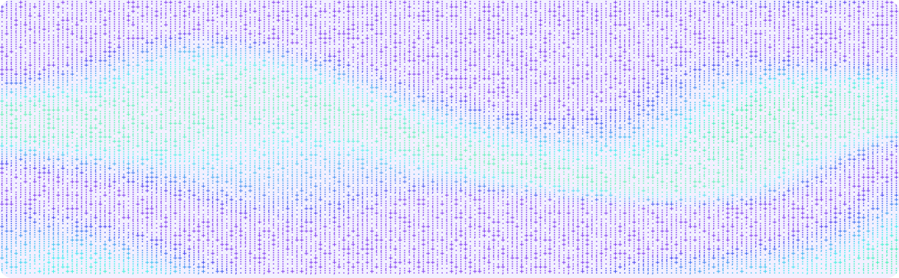

# Harness Bench

**A very small benchmark to find the harness you need.**



[](#try-the-local-demo)
[](notebooks/local-comparison.ipynb)
[](config/harnesses.toml)
[](#inside-the-benchmark)

Choosing an AI agent harness? Start with a few tasks you care about. Compare how agents handle Python, data science, research and everyday work, then inspect their outputs, runtime and failures to decide what fits your workflow.

Eight tasks, a Python notebook and a local Ollama demo get you started. Pi and OpenCode receive the same model, input files and time limit. Add another harness or bring your own tasks as your needs change.

The first experiment asks each harness to evaluate two search systems. Both agents see one set of rankings. The grader runs each agent’s Python program on a second set and checks its recall and reciprocal rank. You can inspect the programs alongside the scores.

[Open the notebook](notebooks/local-comparison.ipynb) · [Try the local demo](#try-the-local-demo) · [Browse the tasks](tasks) · [Add a harness](#extend-the-benchmark)

## Try the local demo

You need [uv](https://docs.astral.sh/uv/getting-started/installation/), Docker with Compose, and [Ollama](https://ollama.com/). Start Docker and Ollama on your machine. On macOS, the trial containers reach Ollama at `host.docker.internal:11434` through OrbStack or Docker Desktop. On Linux, configure that hostname and a reachable Ollama listener first.

```sh
git clone https://github.com/Aurelien7877/harness-bench.git
cd harness-bench
make setup
ollama pull lfm3:1.7b
python3 scripts/local_comparison.py
```

The last line **previews the command**. When you are ready to run one task with both harnesses, use `./bench local`. The [LFM3 1.7B weights](https://ollama.com/library/lfm3:1.7b) occupy about 1.1–1.7 GB in Ollama’s model store. Each agent gets a fresh Docker container with its pinned CLI. LFM3 is intended for small local agents and structured tool use. Its model card cautions against complex agentic coding, so start with the short tasks and inspect any failures.

**Prefer Jupyter?** Open the [comparison notebook](notebooks/local-comparison.ipynb), choose a model and a task suite, then select **Run All**. The notebook prints the terminal command and reads any results you have already saved. The [companion script](scripts/local_comparison.py) also accepts `--run` when you want to start inference.

## Inside the benchmark

| Category | Tasks | What the grader checks |
|---|---:|---|
| Python coding | 2 | Two [HumanEval](https://github.com/openai/human-eval) functions pass their original tests. |
| Data science | 3 | A sales aggregation handles duplicates and refunds. A retrieval script computes recall@3 and MRR@3. A leakage audit identifies features that use future information. |
| Research | 1 | A recommendation cites the authoritative sources in a small collection of conflicting reports. |
| General work | 1 | Invoice balances reconcile after partial payments, duplicated records and excess credit. |
| Context retrieval | 1 | The agent recovers the latest budget and region from a file of revised instructions. |

Pick `demo` for **1 task**, `smoke` for **2**, `quick` for **5** or `full` for **8**. For example, this previews **20 trials** across two harnesses, five tasks and two attempts.

```sh
python3 scripts/local_comparison.py --suite quick --attempts 2
```

## Read the results

Open the `report.md` path printed when the campaign finishes. Use `results.csv` to compare the same task and attempt across harnesses. It includes the grade, status, agent time and available token counts. Blank usage fields mean the harness did not report that value. The manifest records the task hashes, model digest for Ollama runs, and configuration used for the campaign.

If one agent passes and another fails, open both workspaces. Check whether the failing agent misunderstood the metric, wrote a program that only handles the sample, or ran out of time. Repeat promising comparisons with the same model digest, hardware, context length and timeout before drawing conclusions.

## Supported harnesses

| Harnesses | Integration | Inference covered by the launcher |
|---|---|---|
| Pi and OpenCode | [Harbor](https://github.com/harbor-framework/harbor) adapters | Ollama and hosted models |
| Claude Code and Codex | Harbor adapters | Hosted models |
| Oh My Pi (OMP), Factory Droid and DeepSeek Harness | [CLI adapters](adapters/command.py) | Hosted configurations |

See the [harness registry](config/harnesses.toml) for exact versions and credential names. You can check a CLI installation with `./bench install-check --harness droid`.

<details>
<summary><strong>Run a hosted model with a spending limit</strong></summary>

Set a hard spending limit or prepaid balance at your provider and export its API key. The planner reserves EUR 1 per hosted trial and allows EUR 20 per campaign. The provider controls the actual billing limit. Replace the example model ID with one available on your account.

```sh
./bench plan --suite smoke --harness pi --model pi=anthropic/YOUR_MODEL_ID
./bench run --suite smoke --harness pi --model pi=anthropic/YOUR_MODEL_ID --provider-cap-eur 20
```

</details>

<details>
<summary><strong>Verify the graders and inspect disk usage</strong></summary>

```sh
make test
./bench run --suite full --harness oracle --harness nop
./bench doctor
```

The reference solutions should score 8/8 and the idle agent 0/8. These checks use no model key. Trials run sequentially and share a Docker base image. The project’s storage guard stops campaigns at 18 GB in the project folder. Docker layers and Ollama weights live in their own stores.

</details>

## Extend the benchmark

| To change | Start here |
|---|---|
| Local model | Pull a tool-capable Ollama model and pass its tag with `./bench local --model TAG`. |
| CLI version | Edit the pin in [harnesses.toml](config/harnesses.toml), then run its installation check. |
| Harness | Copy the [registry example](config/new-harness.example.toml) and select an upstream adapter or a local adapter class. |
| Task | Add a [Harbor task](tasks), register it in a [suite](config/bench.toml), and check it with both the reference solution and idle agent. |

The Python coding fixtures retain their [HumanEval provenance and license](vendor/humaneval).
