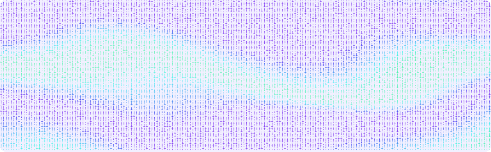

# Harness Bench

**A very small local benchmark to find, or tune, the harness you need.**



[](LICENSE)
[](https://github.com/Aurelien7877/harness-bench/actions/workflows/checks.yml)
[](#try-the-local-demo)
[](notebooks/local-comparison.ipynb)
[](config/harnesses.toml)
[](#inside-the-benchmark)

Choosing an AI agent harness? Start with a few tasks you care about. Compare how agents handle Python, data science, research and everyday work, then inspect their outputs, runtime and failures to decide what fits your workflow.

Twenty-four tasks (twenty-one across seven categories, each with an easy one a small local model can pass, plus three coding tasks that need running code), a no-harness baseline, a Python notebook and a local Ollama demo get you started. Pi and OpenCode receive the same model, input files and time limit. Add another harness or bring your own tasks as your needs change.

The demo starts with a small file and Python check, then asks each harness to evaluate two search systems. All agents see one set of rankings. The grader checks the saved answer, reruns each Python program and checks two additional sets of rankings. You can inspect the programs alongside the scores.

[Open the notebook](notebooks/local-comparison.ipynb) · [Try the local demo](#try-the-local-demo) · [Browse the tasks](tasks) · [Tune your own harness](#tune-your-own-harness) · [Add a harness](#extend-the-benchmark)

## The question

**Same model, same tasks, same container: how much of an agent's result comes from the harness?**

A model is rarely used alone. It sits inside a harness that writes its prompt, picks its tools, decides when to stop and what to remember. Two harnesses can run the identical model weights and still differ in success, in cost and in how long you wait for the first action. Public leaderboards usually change the model and the harness at the same time, so the harness effect stays hidden.

Harness Bench isolates it. Every harness gets the same local model, the same input files, the same time limit and a fresh container. A local proxy then measures each model call the same way for all of them. We ask three things:

1. **Does it work?** Pass rate on 21 graded tasks, with errors and timeouts counted as failures.
2. **How much does it cost?** Tokens, model calls and tool calls per task.
3. **How fast does it feel?** Time to first call, time to first token and latency per call.

This is a screening tool, not a leaderboard. Samples are small and tasks are handpicked, so read it as a way to decide which harness deserves a longer test on *your* work.

## What a harness adds

A small model alone cannot add large numbers exactly or run a simulation. A harness lets it write code, run it and read the result. To measure that, `bare` is the model with no harness: one call, no tools, no retry. It sees the instruction and every file in the workspace, and its reply is saved as the file the task names. The `value` suite has six tasks: three need running code, three do not.

`lfm3:1.7b`, 6 tasks × 3 attempts, 18 trials per row.

| | code-fix-stats | code-roman | code-run-seeds | math-bignum | math-count | math-word | Passed | Median time |
|---|---:|---:|---:|---:|---:|---:|---:|---:|
| No harness | 3/3 | 2/3 | 0/3 | 0/3 | 0/3 | 3/3 | **8/18** | 122 s |
| OpenCode | 3/3 | 3/3 | 3/3 | 3/3 | 3/3 | 3/3 | **18/18** | 76 s |
| Droid | 3/3 | 3/3 | 3/3 | 2/3 | 3/3 | 3/3 | **17/18** | 104 s |
| Pi | 3/3 | 3/3 | 3/3 | 1/3 | 3/3 | 3/3 | **16/18** | 15 s |
| dsh | 2/3 | 3/3 | 3/3 | 2/3 | 0/3 | 3/3 | **13/18** | 131 s |

- Without tools the model fails all nine tasks that need a computation. It reasons until the 8,192-token limit and gives no answer.
- With any harness it writes a few lines of Python, runs them and copies the result.
- On the same task and attempt, OpenCode (p = 0.002), Droid (0.004) and Pi (0.008) beat the model alone; dsh does not (0.125, one of its three `math-count` runs was right but timed out). No two harnesses differ (p ≥ 0.06), but Pi is 5 to 9 times faster.
- The tasks that need no execution (`math-word`, `code-fix-stats`) are passed with or without a harness.

Eighteen paired trials per comparison, with repeated attempts on the same tasks: read the p values as indicative.

```bash
./bench local --suite value --harness bare --harness pi --harness opencode --harness droid --harness dsh --attempts 3
```

## Tune your own harness

The best harness is the one tuned on *your* work, not the one that tops someone else's leaderboard. Harness Bench is built to be that loop on your own machine: your tasks, a local model, no account and no data leaving the laptop (an Ollama cloud model is optional, see [Run faster](#try-the-local-demo)).

1. **Write your tasks.** Copy a [task](tasks) folder: an instruction, input files, a reference solution and a check script. Five to ten real chores of yours beat twenty-one generic ones. Register them in a [suite](config/bench.toml).
2. **Get a baseline.** Run `./bench local --suite mine --harness pi` (or any harness above) and read the pass rate, calls and latency.
3. **Make your harness a registry entry.** Your *self harness* is a CLI plus the choices around it: system prompt, tools, step limit, model, version. Add it from the [registry example](config/new-harness.example.toml), either as a Harbor adapter or as a small class in [adapters/command.py](adapters/command.py) that implements `argv()` and, if needed, `prepare()`.
4. **Change one thing at a time.** Give each variant its own registry name (`mine-short-prompt`, `mine-no-edit-tool`, `mine-8-steps`) and run the same suite with the same model. The notebook's matched comparison shows which variant wins on the same task and attempt.
5. **Keep what wins, then check it.** Hold a few tasks back from tuning and run them last. A variant that only improves the tasks you tuned on is overfitting, not progress.

The repository includes one worked example. `droid-tuned` is Droid plus a short `AGENTS.md` profile ([profiles/droid.md](profiles/droid.md)) and an output check: after each run, the adapter verifies that `answer.json` is valid JSON and that a requested `analyze.py` exists, and re-runs the agent with the problem if not. Each change is logged by root cause in [profiles/droid.sim.json](profiles/droid.sim.json), with the predicted and observed outcome, so later tuning builds on what was already tried. A guidance file alone did not move the pass rate with this small model; the output check is the part to measure. Compare them on held-back tasks:

```bash
./bench local --suite tune-test --harness droid --harness droid-tuned --attempts 3
```

Harness Bench measures and compares; you decide what to change. The measures it adds to a pass rate (calls, tool calls, time to first call, tokens) tell you *why* a variant is better, for instance fewer wasted calls or a faster start, so you can tune toward the failure you actually have.

## Try the local demo

You need [uv](https://docs.astral.sh/uv/getting-started/installation/), Docker with Compose, and [Ollama](https://ollama.com/). Start Docker and Ollama on your machine. On macOS, the trial containers reach Ollama at `host.docker.internal:11434` through OrbStack or Docker Desktop. On Linux, configure that hostname and a reachable Ollama listener first.

```sh
git clone https://github.com/Aurelien7877/harness-bench.git
cd harness-bench
make setup
ollama pull lfm3:1.7b
python3 scripts/local_comparison.py
```

The last line **previews the command**. When you are ready to run the demo with both harnesses, use `./bench local`. The default model is [LFM3 1.7B](https://ollama.com/library/lfm3:1.7b). You can choose another installed Ollama model with tool support. Each agent gets a fresh Docker container from a shared image that already contains the pinned CLIs, so a trial starts in about a second. Model weights and Docker layers live outside the project folder.

**Prefer Jupyter?** Open the [comparison notebook](notebooks/local-comparison.ipynb), choose a model and a task suite, then run the preparation and comparison cells. The notebook opens saved results by default. For a new campaign, the preparation cell builds the shared image and downloads the selected model when needed. The notebook opens the saved `value` campaign, a six-task suite compared with the no-harness baseline. It previews every task and the number of trials before setup. Set `run_new_campaign = True` to run with tqdm progress, then inspect work success, outcomes, runtime, diagnostics and scores by task and category. The [companion script](scripts/local_comparison.py) also accepts `--run` when you want to start inference.

## Inside the benchmark

| Category | Tasks | What the grader checks |
|---|---:|---|
| Startup | 3 | Read a file, write a script and calculate a count and sum; count words; write a greeting. Scored separately. |
| Python coding | 6 | Three [HumanEval](https://github.com/openai/human-eval) functions pass their original tests, one of them trivial. Three more need running code: fix three bugs until a visible test passes, run a simulation for three seeds, write a Roman-numeral converter that passes a round-trip check. |
| Data science | 3 | A sales aggregation handles duplicates and refunds. A retrieval script computes recall@3 and MRR@3. A leakage audit identifies features that use future information. |
| Research | 3 | A recommendation cites the authoritative sources in conflicting reports; find the latest release; find the MIT-licensed library. |
| General work | 3 | Invoice balances reconcile after partial payments and duplicates; expenses are totalled by category; emails are deduplicated. |
| Math | 3 | A word problem, then two exact computations (large arithmetic, counting and primes) that a small model rarely gets right without running code. |
| Context retrieval | 3 | The agent recovers the latest budget and region from revised instructions, an access code from a long log, and the current contact email. |

Pick `demo` for **2 tasks**, `smoke` for **3**, `quick` for **8**, `math` for **3**, `value` for the **6** tasks that show what a harness adds, `full` for **21**, or `tune` for the **6** tasks used to compare a tuned harness (`tune-dev` and `tune-test` are its two halves). For example, this previews **32 trials** across two harnesses, eight tasks and two attempts.

```sh
python3 scripts/local_comparison.py --suite quick --attempts 2
```

You can include Droid and DeepSeek Harness in the notebook:

```python
model = "lfm3:1.7b"
harnesses = ["pi", "opencode", "droid", "dsh"]
```

The local routes for Droid 1.14.0 and DeepSeek Harness 0.2.2-rc.1 use Ollama's Chat Completions endpoint. All four local harnesses completed the two-task `demo` suite with `lfm3:1.7b`; this repository does not claim successful execution for other tasks, CLIs or models. Droid may request Factory authentication depending on its CLI and account requirements. The pinned versions live in the registry so each experiment records a specific version.

The notebook preparation cell refreshes stale execution dependencies before a new campaign. For terminal use after a repository update, `make setup-python` synchronizes those dependencies without building images or running a model. Existing reports remain readable; the launcher rejects stale execution libraries.

**Run faster.**

- **Preinstalled CLIs.** `make setup` (or the first campaign) builds one image with Pi, OpenCode, Droid and DeepSeek Harness at the versions in `config/harnesses.toml`. It rebuilds only when a version changes. In our `full` campaign, installing the CLIs took 27% of the time (about 32 s per trial); it now takes 1 to 2 s.
- **Ollama cloud models.** Use a tag such as `glm-5.3-flash:cloud` after `ollama signin`. Calls go through your local Ollama, so the measuring proxy is unchanged. Cloud trials run up to 3 at once, the concurrent-request limit of the pay-as-you-go and Pro plans (`--concurrency` raises it, for example on Max), each with its own proxy. The proxy retries a busy service (429, 502, 503) before any reply byte. Cloud inference is billed per token, and prompts leave your machine; the tasks here are synthetic. Compare latency across harnesses within one campaign only: it measures the network and the service, not your hardware.
- **API providers.** `./bench local --provider gemini --model MODEL` sends calls to a provider defined in `config/bench.toml`. The key is read from `GEMINI_API_KEY` (environment or the git-ignored `.env`); the proxy adds it, so containers only hold a dummy value. Check the plan first: Google's free tier allowed 20 requests per day for `gemini-3.6-flash` when we tried it, far below one campaign, and Gemini 3 models reject multi-step tool use from clients that do not echo back a `thought_signature`. Use a paid plan, or a provider whose limits you have read.
- **Housekeeping.** `make prune` frees Docker build cache older than a week. Trials of a local model stay sequential on purpose, because parallel runs would share one GPU and distort timings.

**Interrupted?** Every trial is saved as soon as it ends, and `results.csv` and `report.md` are refreshed after each one. Resume with `./bench local --resume runs/campaigns/CAMPAIGN_ID`: finished trials are kept, interrupted or technically failed ones are rerun (their earlier files move to `runs/jobs/_retried`). A resumed campaign keeps its original settings and harness versions, and refuses to continue if a task or the model weights changed. A harness with three consecutive technical errors is skipped for the rest of the campaign instead of wasting hours.

## Read the results

**Startup is a health check, not part of the work score.** A passing work trial must satisfy every required check. Diagnostics explain failures without turning them into partial successes.

Open the `report.md` path printed when the campaign finishes. Use `results.csv` to compare the same task and attempt across harnesses. It includes the grade, status, agent time, tokens, LLM calls, tool calls, time to first call, call latency and time to first token. Blank fields mean the value was not measured. Local campaigns route every harness through a logging proxy (`llm_proxy_port` in `config/bench.toml`, default 11436), so calls, latency and tokens are measured the same way for all harnesses. Token counts come from the harness when it reports them, otherwise from the proxy (`tokens_source`; `proxy_partial` means some calls reported no usage, so the total is a lower bound). Time to first call runs from the start of the agent phase and includes harness start-up. The manifest records the task hashes, model digest for Ollama runs, and configuration used for the campaign.

The notebook includes a compact summary table, 0% labels, exploratory 95% intervals, category and task heatmaps, and same-model matched outcomes with an exact sign test. Token and cost totals show their measurement coverage. Unknown values stay unknown. See [how to interpret the statistics](docs/methodology.md).

If one agent passes and another fails, open both workspaces. Check whether the failing agent misunderstood the metric, wrote a program that only handles the sample, or ran out of time. Repeat promising comparisons with the same model digest, hardware, context length and timeout before drawing conclusions.

## Supported harnesses

The four harnesses compared in local campaigns. The first rows come from the npm metadata of each pinned version and from tool calls observed in our trials; the rows from "Non-interactive mode" down come from the official documentation.

| | **Pi** | **OpenCode** | **Factory Droid** | **DeepSeek Harness (dsh)** |
|---|---|---|---|---|
| Pinned version | 1.5.2 | 1.19.6 | 1.14.0 | 0.2.2-rc.1 |
| npm package | `@earendil-works/pi-coding-agent` (legacy name for older versions) | `opencode-ai` | `@factory/cli` | `@deepseek-ai/dsh` |
| License | MIT | MIT | Proprietary (`UNLICENSED`) | MIT |
| Runtime declared upstream | Node ≥ 22.19 | Native binary | Node ≥ 20 | Node ≥ 24.9 |
| Integration here | Upstream Harbor adapter (`LocalPi` wrapper for local limits) | Upstream Harbor adapter | [Local CLI adapter](adapters/command.py) | [Local CLI adapter](adapters/command.py) |
| Local model route | OpenAI-compatible endpoint | OpenAI-compatible custom provider | Custom model, Chat Completions | Custom provider, `openai-completions` |
| Tools seen in trials | `read`, `bash`, `edit`, `write` | `read`, `bash`, `edit`, `write` | `Read`, `Execute`, `Edit`, `Create` | `read`, `glob`, `bash`, `edit`, `write` |
| Token usage reported by the harness | Yes | Yes | No | No (the proxy fills it) |
| Account needed for local use | No | No | May ask for Factory authentication | No |
| Result trace | Harbor trajectory with step timestamps | Harbor trajectory with step timestamps | Native event stream | Native event stream, profile-based config |
| Non-interactive mode | `-p` (print), `--mode json` (JSONL events) | `opencode run "<prompt>"` | `droid exec`, `--auto low\|medium\|high`, stream-json output | `--profile headless`, final answer on stdout |
| Permission model | None built in: runs with the user's rights, containerization recommended | Ordered allow/ask/deny rules per action and resource | Autonomy levels (off, low, medium, high), permission rules, secret scanning | `workspace-write` sandbox by default; reads and network not confined |
| Subagents | Not built in (add by extension) | Built in (`general`, `explore`, custom agents) | Built in (`worker`, `explorer`, custom droids) | Optional Codex / Claude Code subagent bundles |
| MCP | stdio and streamable HTTP; tools exposed through a `codemode` layer by default | stdio and remote with OAuth | stdio, HTTP and legacy SSE | Off by default; servers treated as trusted code |
| Context compaction | Automatic, plus `/compact` | Automatic, configurable | `/compress`, token limits in settings | Automatic in the `minimal` agent preset, plus `/compact` |
| Extensibility | Extensions, skills, prompt templates, Pi packages | Plugins, skills, commands, agents | Hooks, skills, plugins, custom droids | Everything is a plugin; profiles are stacks of patch layers |
| Data leaving the machine | `/share` and `/bug` only when you run them | Not stated in the pages read | Cloud session sync on by default | Session-log upload (official DeepSeek API) and OTel upload on by default; we set `DSH_TELEMETRY_DISABLED=1` |
| Maturity | Not stated (its separate Radius gateway is in early alpha) | Stable v1 pinned here; the online docs describe v2 | Commercial product | Developer preview, "compatibility-breaking changes" expected |

**Sources and caveats.** Rows from "Non-interactive mode" down come from the official documentation read on 18 November 2026: [Pi](https://github.com/earendil-works/pi), [OpenCode](https://opencode.ai/docs), [Factory Droid](https://docs.factory.com) and [DeepSeek Harness](https://github.com/deepseek-ai/deepseek-harness). Not every page was read.

- **OpenCode:** the online docs describe v2 (`@opencode/cli`, a `shell` tool, `permissions`). This benchmark pins v1.19.6, which exposes `bash` and `opencode-ai`, so details may differ for the pinned version. The license row comes from npm, since no docs page stated it.
- **Droid:** the docs name the npm package `droid`; we pin `@factory/cli` 1.14.0. The docs did not confirm local OpenAI-compatible endpoints; our trials worked with a custom model entry. The docs state "All rights reserved", consistent with the proprietary license in npm.
- **dsh:** the docs do not mention the `--json`, `--permission-mode` and `--approval-policy` flags that the adapter passes to 0.2.2-rc.1, and the version itself is not stated there. The flags worked in our trials; treat them as specific to the pinned release candidate.
- **Pi:** the local-endpoint page (`models.md`) was not read; local use is confirmed by our trials, not by the pages read.

**Results.** Full suite, 21 tasks, one attempt, `lfm3:1.7b`, one machine.

| | Pi | OpenCode | dsh | Droid |
|---|---:|---:|---:|---:|
| Work tasks passed | 17/20 | 16/20 | 16/20 | 14/20 |
| 95% interval | 64 to 95% | 58 to 92% | 58 to 92% | 48 to 86% |
| Median agent time | 13 s | 26 s | 48 s | 46 s |
| Model calls per task (median) | 5 | 6 | 9 | 4 |
| Input tokens, all trials | 0.61 M | 0.81 M | 3.66 M | 1.08 M |
| Time to first call | 0.8 s | 1.2 s | 1.4 s | 1.0 s |

Success rates are not distinguishable: the intervals overlap and no pair differs on the same tasks (sign test, p ≥ 0.45). Cost and speed differ clearly: dsh sends about six times the input tokens of Pi, and Pi answers each call fastest. Data-science tasks are the hardest for this model across harnesses. Three attempts per task are needed before ranking on success.

Other harnesses supported by the launcher:

| Harnesses | Integration | Inference covered by the launcher |
|---|---|---|
| Claude Code and Codex | Harbor adapters | Hosted models |
| Oh My Pi (OMP) | CLI adapter | Hosted configurations |

See the [harness registry](config/harnesses.toml) for exact versions and credential names. You can check a CLI installation with `./bench install-check --harness droid`.

<details>
<summary><strong>Run a hosted model with a spending limit</strong></summary>

Set a hard spending limit or prepaid balance at your provider and export its API key. The planner reserves EUR 1 per hosted trial and allows EUR 20 per campaign. The provider controls the actual billing limit. Replace the example model ID with one available on your account.

```sh
./bench plan --suite smoke --harness pi --model pi=anthropic/YOUR_MODEL_ID
./bench run --suite smoke --harness pi --model pi=anthropic/YOUR_MODEL_ID --provider-cap-eur 20
```

</details>

<details>
<summary><strong>Verify the graders and inspect disk usage</strong></summary>

```sh
make test
./bench run --suite full --harness oracle --harness nop
./bench doctor
```

The reference solutions should score 21/21 and the idle agent 0/21. These checks use no model key. Local trials run sequentially and share a Docker base image. The project’s storage guard stops campaigns at 18 GB in the project folder. Docker layers and Ollama weights live in their own stores.

</details>

## Extend the benchmark

| To change | Start here |
|---|---|
| Local model | Pull a tool-capable Ollama model and pass its tag with `./bench local --model TAG`. |
| CLI version | Edit the pin in [harnesses.toml](config/harnesses.toml), then run its installation check. |
| Harness | Copy the [registry example](config/new-harness.example.toml) and select an upstream adapter or a local adapter class. |
| Task | Add a [Harbor task](tasks), register it in a [suite](config/bench.toml), and check it with both the reference solution and idle agent. |

See the [task catalog](docs/tasks.md), [evaluation methodology](docs/methodology.md) and [publication checks](SECURITY.md). `make check` runs unit tests, configuration validation and the publication scan without a container or model. Use `make setup-python` if you only need the Python environment for those checks.

The project is [MIT licensed](LICENSE). The Python coding fixtures retain their [HumanEval provenance and license](vendor/humaneval).
